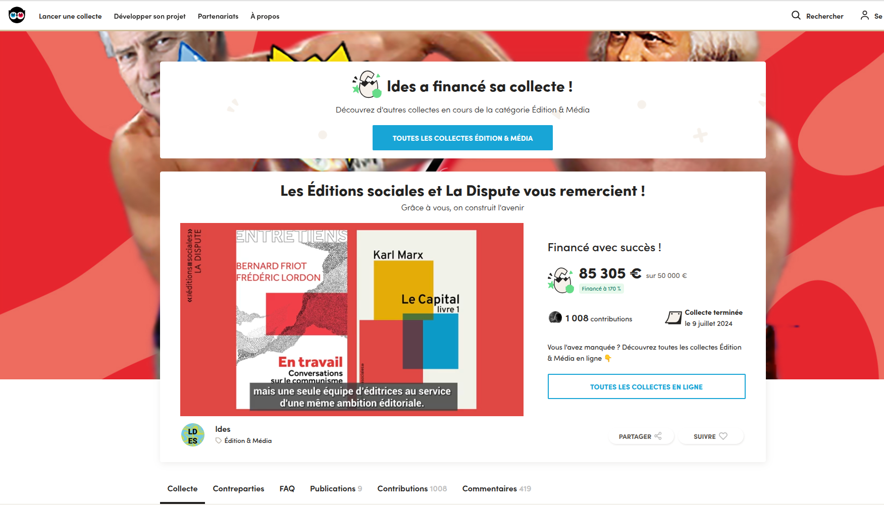

§§§§§§§§§§§§§§§§§§§§§§§§§§§§§§§§§§§§§§§§§§§§§

### Que font les distributeurs ? 

#### Le référencement
* mise à jour des catalogues de libraires (Dilicom, Électre), rédaction de fiches descriptives pour les libraires

#### Le stockage
* gestion des stocks de livres imprimés (entreposage, inventaire)
 
#### La gestion des expéditions et des retours & La facturation
* Envoi des commandes, gestion des retours, mise au pilon...

===

Tâches des distributeurs : 

- Référencement : Les livres sont référencés dans le catalogue des libraires via des entités comme Dilicom ou Electre. Ainsi, les libraires ont accès à une fiche de votre livre sur leur logiciel, ce qui leur permet de commander des exemplaires de votre livre à la demande des clients ou pour le placer en rayon.

- Gestion de stock : Dans un premier temps, le distributeur gère le stock de livres imprimés. C’est toujours utile si le premier tirage de votre ouvrage s’élève à plusieurs milliers d’exemplaires, l’éditeur ne pouvant stocker des dizaines de cartons pesant une tonne dans son bureau...

Le stockage est aujourd'hui devenu un enjeu majeur face à la masse des ouvrages publiés, dans un contexte de concentration. Pour un petit éditeur qui aurait une vingtaine de titres à son catalogue, tirés à 4 000 exemplaires chacun, la location de locaux représenterait ainsi des frais voisins de 5 000 euros par an.

Selon Bertrand Legendre : 

>Le système incite financièrement les éditeurs à privilégier les ouvrages à rotation rapide ou à assurer eux-mêmes le stockage de leurs fonds dans des conditions moins coûteuses pour ne maintenir que des quantités minimales chez le distributeur. La question des stocks se pose aussi de manière particulièrement sensible pour les petits éditeurs qui ont confié leurs tirages à des structures de distribution fragiles ; les faillites successives de Distique et d’Alterdis ont ainsi privé certains d’entre eux à la fois des recettes des en-cours, mais aussi de leurs propres stocks. 

La rotation correspond au nombre de fois où l’on vend le stock dans l’année. Plus la rotation moyenne d’une librairie est élevée, plus le stock se vend souvent, et donc la rentabilité de ce stock est bonne.

On voit ici comment la chaîne du livre entretient un cercle vicieux : la rentabilité d'un livre se calcule aussi selon la vitesse de "rotation" en librairie : tout l'enjeux est d'avoir donc des stocks qui s'écoulent vite, tant chez le libraire que, par conséquent, chez le distributeur qui s'occupe d'approvisionner les libraires.

- la logistique d'expédition, retour, facturation

Selon les éditeurs, une politique de retour des livres invendus est mise en place, ainsi que la mise au pilon (destruction). Cette étape, qui permet aux éditeurs et aux auteurs de minimiser les risques financiers est, paradoxalement, facturée très cher par les distributeurs, ce qui explique que certains éditeurs ne gèrent pas cet aspect.

§§§§§§§§§§§§§§§§§§§§§§§§§§§§§§§§§§§§§§§§§§§§§

#### Quelques exemples de tâches pour le diffuseur
* Définition avec l'éditeur des objectifs de vente (combien d'exemplaires insérer sur le marché ?)
* Démarchage des points de vente pour faire connaître le catalogue de l'éditeur
* Produire et distribuer des supports de promotion
* Assurer le réassort des livres pour éviter les ruptures de stock

<!-- .element: style="font-size:1.4rem; text-align:justify" -->

===

Définir avec votre éditeur un objectif de nombre d’exemplaires de livres à insérer sur le marché.
Démarcher les points de vente pour leur faire connaitre le catalogue de votre éditeur et les convaincre de commander des exemplaires.
Fournir aux points de vente des supports de promotion pour mieux vendre : kakémonos, présentoirs, affiches, etc.
Prendre les commandes réceptionnées par les points de vente et les fournir à votre éditeur (qui les fournit ensuite au distributeur).
Assurer le réassort des livres dans les points de vente pour éviter les ruptures de stock.
Sensibiliser les points de vente sur les nouveautés littéraires de votre éditeur, puis reprendre au point 3., et ainsi de suite.

Bref, les diffuseurs font du porte-à-porte dans l’espoir de placer en rayon les livres de votre éditeur. Ça peut paraître normal, mais ça reste une exception dans le monde de l’édition. Peu d’éditeurs peuvent recourir aux services d’un diffuseur car ça coûte très cher et c’est un milieu élitiste. Les diffuseurs ne travaillent qu’avec des grands noms de l’édition, les éditeurs indépendants ne les intéressant guère.

§§§§§§§§§§§§§§§§§§§§§§§§§§§§§§§§§§§§§§§§§§§§§

===

C'est ce qui explique qu'un groupe, aujourd'hui, est toujours formé de maisons + de distributeurs. Et c'est le cas aussi pour les maisons historiques : Loin d’être demeurées de simples maisons d’édition, avant tout soucieuses de création littéraire et de renforcement des collections qui en sont la carte d’identité, elles ont toutes investi considérablement dans le secteur de la diffusion et celui de la distribution. 

Récemment, en 2019, le CDE (Centre de diffusion de l’édition), la société appartenant à Madrigall, a demandé à une quarantaine d’éditeurs jusque-là diffusés, de partir et de trouver un autre prestataire de services avant le 31 décembre. 

Les seuls diffuseurs disponibles, c’est-à-dire n’appartenant pas aux grands groupes, Harmonia Mundi, les Belles Lettres, Pollen, Paon Diffusion, Dod et Cie, DG Diffusion, Hobo, Serendip et quelques autres, étaient en effet assaillis de demandes et ne pouvaient reprendre la totalité des éditeurs jetés sur le pavé. 

Exemple de prise en charge de l'indépendance : une campagne ULULE. ON aura l'occasion d'y revenir.