## Qui "gouverne" le monde de l'édition ?

#### Indépendance(s), concentration(s) et bibliodiversité

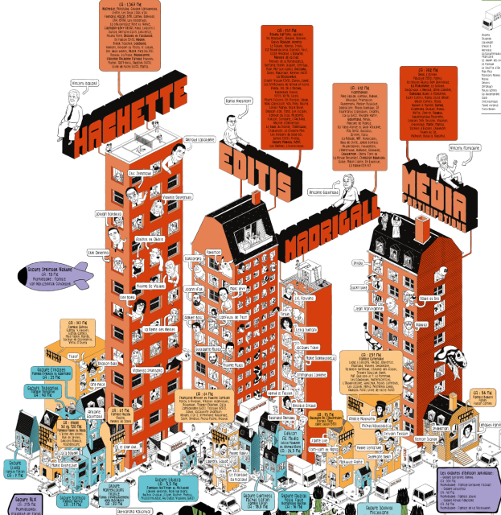<!-- .element: style="width:300px" -->

===

Dans ce cours, nous allons aborder la question de la gouvernance de l'édition.

La gouvernance est un concept qui renvoie à la manière dont un domaine d'activités est gouverné. La gouvernance renvoie à un système d'entités décisionnelles qui dirige un certain domaine d'activités, autrement dit à un « système de gouvernance », impliquant notamment une structure de gouvernance et un dynamisme de système (processus de gouvernance, activités de gestion, etc).

On pourrait passer tout un semestre sur ces questions, je n'y consacrerai que cette heure, de manière à baliser quelques problématiques qui me semblent essentielles, notamment pour introduire les autres thématiques que nous aborderons les prochaines semaines. 

L'angle que je vais choisir est celui de l'opposition, ou de la tension qui oppose, en France, le phénomène déjà ancien de "concentration éditoriale", que vous connaissez sans doute très bien parce qu'il est souvent mentionné, y compris pour parler du système médiatique, au concept un peu plus flou "d'édition indépendante". 

La question que je veux donc poser avec vous, c'est celle de l'indépendance de l'édition (qui excède la seule problématique des éditions "indépendante"), indépendance en matière de choix éditoriaux, chois de forme et de contenu, autrement dit en matière de "Bibliodiversité".

La bibliodiversité = c'est l'équivalent culturel du concept de biodiversité pour la nature. On y reviendra, la bibliodiversité, c'est la garantie d'une pluralité et d'un pluralisme de contenus, de formes, de voix, d'auteurs, d'éditeurs... la garantie d'une culture hétérogène, et non pas standardisée (sur le plan des idées, évidemment, mais également sur le plan des formes esthétiques). 

§§§§§§§§§§§§§§§§§§§§§§§§§§§§§§§§§§§§§§§§§§§§§
<!-- .slide: data-background-video="img/Arte_journal_Grasset.mp4" data-background-size="contain" -->

§§§§§§§§§§§§§§§§§§§§§§§§§§§§§§§§§§§§§§§§§§§§§

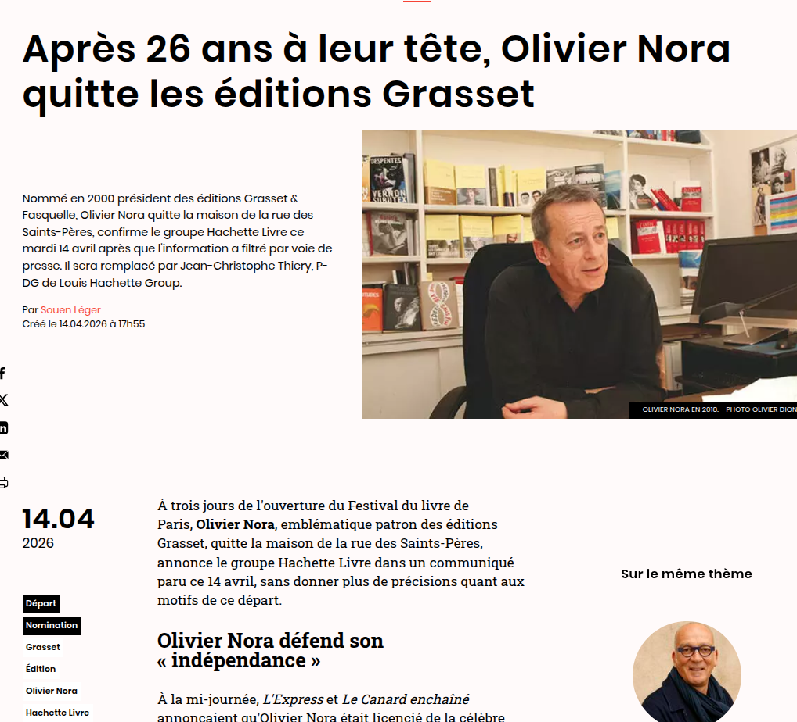<!-- .element: style="width:45%;float:left;margin-right:-1em;" -->

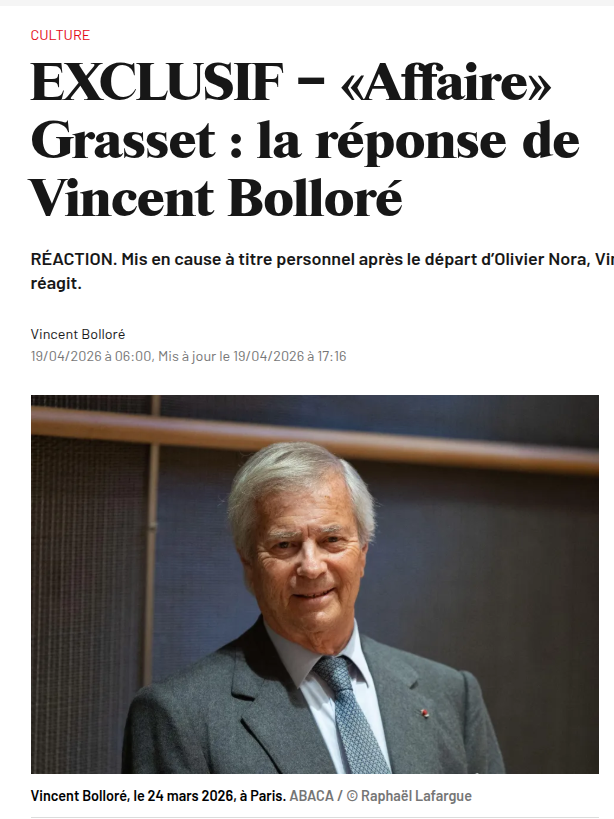<!-- .element: style="width:45%;float:right;margin-right:-1em;" -->

===

Séisme de forte magnitude dans l'édition française : le 14 avril 2026, le renvoi ou "limogeage" de l'éditeur Olivier Nora de Grasset, après 26 ans à la tête de la maison. 
Qui est à l'origine de ce limogeage ? Bolloré, qui est le propriétaire d'Hachette, Hachette elle-même un oligipole qui possède Grasset. 

Quelques semaines plus tôt, Grasset avait annoncé l'arrivée de Boualem Sansal. Selon une source proche du dossier citée par l'AFP, le départ de Nora est lié à un désaccord sur la date de sortie du prochain livre de Sansal, consacré à sa détention en Algérie. 

Vincent Bolloré a donné sa version dans le JDD (qu'il possède) le 19 avril :  

>Le dirigeant de Grasset voulait le sortir à la fin de l’année – ce qui était contraire à la volonté de la direction Hachette, qui est le réel propriétaire de Grasset. En entreprise comme en démocratie, la majorité décide in fine…

>Ce différend a eu lieu sur fond de performances économiques de la Maison Grasset très décevantes : le chiffre d’affaires, qui était de 16,5 millions d’euros en 2024, est descendu à 12 millions en 2025 et le résultat opérationnel, qui était de 1,2 million d’euros en 2024, a diminué de moitié pour ne représenter plus que 0,6 million en 2025. Pendant ce même temps, la rémunération annuelle d’Olivier Nora est passée de 830 000 euros à 1,017 million d’euros

§§§§§§§§§§§§§§§§§§§§§§§§§§§§§§§§§§§§§§§§§§§§§

>N’ayons pas peur ! Grasset continuera et ceux qui partent vont permettre à de nouveaux auteurs d’être publiés, promus, reconnus et appréciés. J’aime depuis mon enfance et grâce à ma famille profondément la littérature et suis attaché à aider ses auteurs à pouvoir être diffusés. Quant aux attaques concernant mon « idéologie », je le rappelle une fois de plus : je suis chrétien démocrate et les dirigeants de Hachette continueront à publier tous les auteurs qui le souhaitent. 

<!-- .element: style="font-size:1.3rem; text-align:center" -->

Vincent Bolloré, 19/04/26, dans le JDD

<!-- .element: style="font-size:1.3rem; text-align:right" -->

===

Dans le JDD, Bolloré s'exprime (après avoir attaqué les ) : 

>N’ayons pas peur ! Grasset continuera et ceux qui partent vont permettre à de nouveaux auteurs d’être publiés, promus, reconnus et appréciés. J’aime depuis mon enfance et grâce à ma famille profondément la littérature et suis attaché à aider ses auteurs à pouvoir être diffusés. Quant aux attaques concernant mon « idéologie », je le rappelle une fois de plus : je suis chrétien démocrate et les dirigeants de Hachette continueront à publier tous les auteurs qui le souhaitent.

Le conflit se lit donc de deux façons : pour le patron de Hachette, Bolloré, c'est un simple arbitrage de calendrier pour l'actionnaire.

§§§§§§§§§§§§§§§§§§§§§§§§§§§§§§§§§§§§§§§§§§§§§

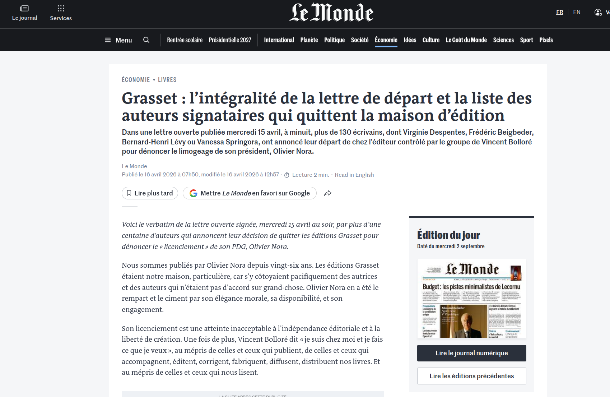<!-- .element: style="width:50%;float:left;margin-right:-1em;" -->

<!-- .element: style="width:40%;float:right;margin-right:-1em;" -->

===

Mais pour ses opposants, il s'agit d'une atteinte à l'indépendance éditoriale.

Immédiatement, des auteurs décident de partir. Ils s'organisent en collectif. En cette rentrée littéraire paraît *La grande évasion*, un collectif qui parle d'indépendance etc. 

§§§§§§§§§§§§§§§§§§§§§§§§§§§§§§§§§§§§§§§§§§§§§

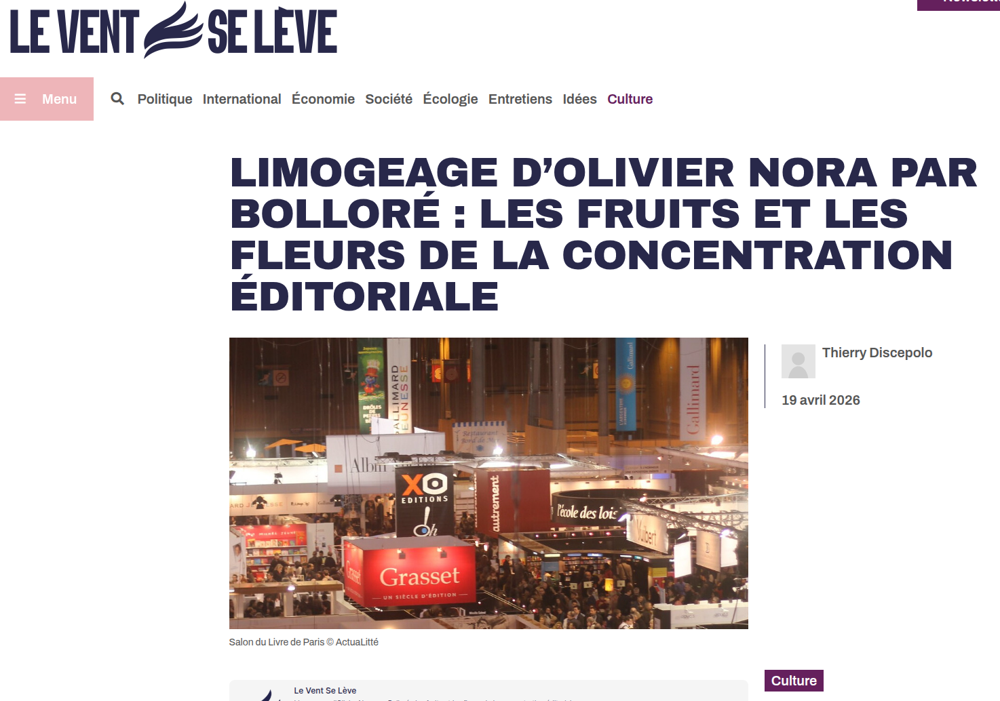<!-- .element: style="width:45%;float:right;margin-right:-1em;" -->

>À l’aube des années 2020, la conjugaison d’une concentration éditoriale galopante et d’une malheureuse transmission d’héritage entre Jean-Luc et Arnaud Lagardère livrait la maison Hachette aux mains de Vincent Bolloré. En mars 2021, un désaccord entre le milliardaire breton et Arnaud Nourry, le PDG du groupe, débouche sur son licenciement. Nora ne bouge pas, ses auteurs non plus.
>Un an plus tard, un tollé accompagne l’accueil par Vincent Bolloré de Rubempré, maison fondée par Éric Zemmour pour lancer sa campagne avec son dernier livre, La France n’a pas dit son dernier mot. Nora ne bouge pas, ses auteurs non plus.  Thierry Discepolo, dans *Agone*.

<!-- .element: style="width:45%;float:left;margin-left:-1em; font-size:1.2rem; text-align:right" -->

===

Du côté de l'édition indé et engagée, on s'amuse un peu de ce réveil tardif. 
La figure ambigüe de Nora est d'ailleurs moquée par certains, comme  Thierry Discepolo, fondateur de la revue Agone et des éditions du même nom, auteur de *La Trahison des éditeurs*.

§§§§§§§§§§§§§§§§§§§§§§§§§§§§§§§§§§§§§§§§§§§§§

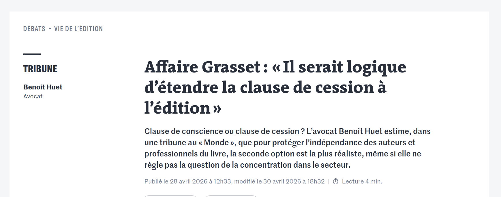<!-- .element: style="width:400px" -->

Les droits sur le catalogue sont la propriété des éditeurs jusqu’à soixante-dix ans après la mort des auteurs et peuvent en conséquence avoir une valeur marchande substantielle. Combien valent ainsi les droits sur l’œuvre de Leïla Slimani ou d’Emmanuel Carrère ? Difficile à dire. Transférer les droits sur un catalogue d’œuvres impliquerait ainsi une transaction dont le prix est subjectif, ce qui ne semble pas conciliable avec l’idée d’une cession imposée par la loi. [...] Une clause de cession au bénéfice des auteurs pourrait en revanche être prévue sur les contrats d’édition pour lesquels une publication n’est pas encore intervenue. En cas de cession de la maison d’édition, l’auteur serait ainsi en mesure d’exiger la résolution du contrat d’édition en cours : l’auteur devrait rembourser son à-valoir ; et l’éditeur, renoncer à tout droit sur l’ouvrage.

<!-- .element: style="font-size:1.3rem; text-align:center" -->

Benoit Huet, dans *Le Monde*.

<!-- .element: style="font-size:1.3rem; text-align:right" -->

§§§§§§§§§§§§§§§§§§§§§§§§§§§§§§§§§§§§§§§§§§§§§

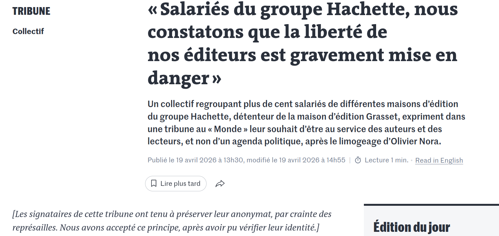<!-- .element: style="width:45%;float:right;margin-right:-1em;" -->

>Nous encourageons le monde politique à s’emparer du sujet le plus rapidement possible car la situation est alarmante et concerne l’ensemble du secteur culturel et au-delà. La concentration de maisons d’édition et de médias est un enjeu démocratique de premier plan et un véritable danger. Nous souhaitons être au service des auteurs et des lecteurs et non d’un agenda politique.

<!-- .element: style="width:45%;float:left;margin-left:-1em; font-size:1.4rem; text-align:justify" -->

===

>Mais, au-delà des auteurs, qu’en est-il des salariés des maisons d’édition, qui sont les vrais « prisonniers » de la prise de contrôle hostile de l’éditeur par un actionnaire idéologue ? En l’état actuel de la loi, les salariés des maisons d’édition, dont beaucoup font un travail qui suppose une implication intellectuelle très personnelle, sont condamnés à travailler avec le repreneur, ou à démissionner sans compensation.

§§§§§§§§§§§§§§§§§§§§§§§§§§§§§§§§§§§§§§§§§§§§§

### Des questions en bataille... 
Comment en sommes-nous arrivés là ?  
Que devient la bibliodiversité quand le premier éditeur français est aussi lié à un empire médiatique ? 
La propriété d'une maison implique-t-elle le contrôle du calendrier et du catalogue ?  
Les départs d'auteurs sont-ils un contre-pouvoir réel, quand les contrats et le droit de préférence les lient ?  
Le phénomène de concentration comprend-t-il réellement un risque idéologique, et donc démocratique ?

===

Comment en sommes-nous arrivés là ? Via un phénomène de concentration qui n'a cessé de s'aggraver, au détriment surtout de l'édition "intermédiaire". Création d'un phénomène de polarisation entre très grosses et très petites structures.

La propriété d'une maison implique-t-elle le contrôle du calendrier et du catalogue ? 
Cette deux question renvoie à un problème marketing : le contenu littéraire, les dates de publi etc. (ce qui est l'argument de Bolloré)

Que devient la bibliodiversité quand le premier éditeur français est aussi lié à un empire médiatique ?
Cette question renvoie à la fabrique du livre, et à une maîtrise de la chaîne industrielle du livre. On en reparlera avec le cas des distributeurs. 

Les départs d'auteurs sont-ils un contre-pouvoir réel, quand les contrats et le droit de préférence les lient ?
Le phénomène de concentration comprend-t-il réellement un risque idéologique, et donc démocratique ?
Ces questions envoie à la notion d'indépendance politique... 

§§§§§§§§§§§§§§§§§§§§§§§§§§§§§§§§§§§§§§§§§§§§§

##### Le planisphère de l'édition 2025 (LivreHebdo)

<!-- .element: style="width:400px" -->

===

On va commencer par une analyse de terrain.

Vous les avez peut-être croisées, il existe plusieurs tentatives de cartographie de l'édition française, que l'on peut se procurer de manière à se faire une petite idée de la gouvernance. Je voudrais en passer en revue 3 avec vous, en vous rappelant qu'un cartographie n'est jamais neutre : c'est le piège, elle a vocation à rendre un paysage appréhendable et donc à l'objectiver, mais en vérité il y a toujours des partis pris, des représentations parfois inconscientes, des biais, et donc des visions un peu biaisées du monde (c'est pour cela que l'Europe est aujourd'hui encore au centre des planisphères).  

Chaque année, ainsi, à la rentrée Livre Hebdo publie son "planisphère de l'édition française". Ce planisphère est assez schématique, il va faire la part belle aux gros acteurs du secteur (Editis, Hachette, Madrigall), mais il a ceci de pratique qu'il met bien en évidence les liens entre les éditeurs et leurs distributeurs.

Je passe de suite à la suivante, et on reviendra sur cet enjeu de la distribution.

§§§§§§§§§§§§§§§§§§§§§§§§§§§§§§§§§§§§§§§§§§§§§  

##### Édition française, qui possède quoi ? (Le Monde diplomatique/Agone éditions)

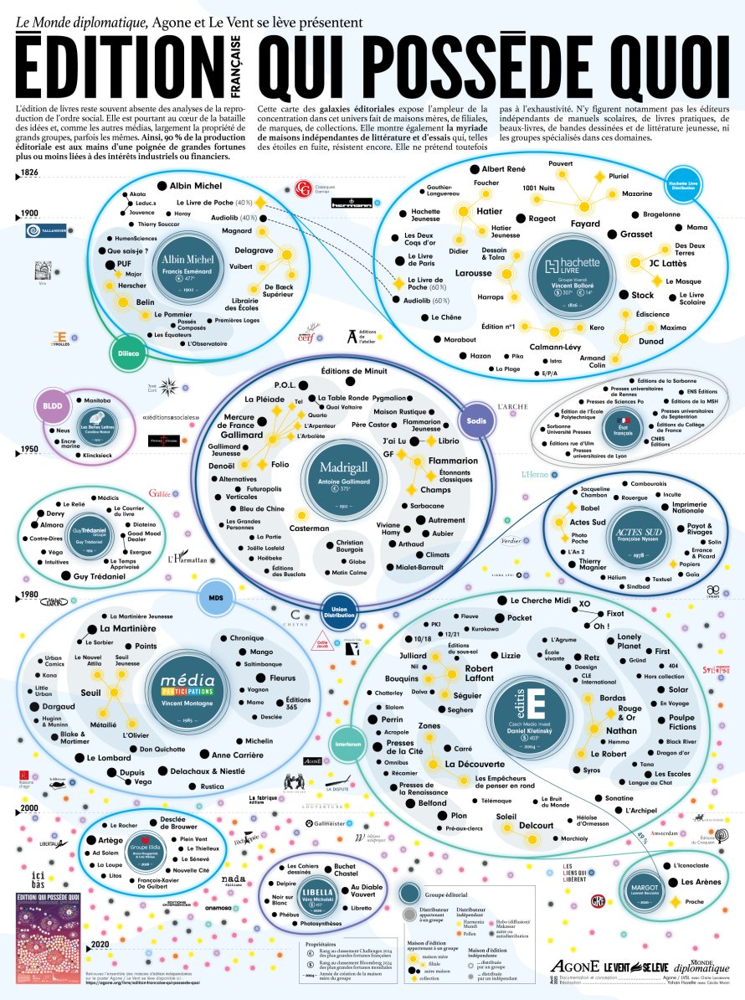<!-- .element: style="width:400px" -->

===

Seconde carte : Édition française, qui possède quoi ? (Le Monde diplomatique/Agone éditions), avril 2025. 
Agone Édition : publication de *La Trahison des éditeurs* de Thierry Discepolo (qui en est à sa 3e édition depuis 2011), et qui dénonce depuis 15 ans la concentration éditoriale.

Cette carte est engagée, je vous en lit la présentation du le site des éditions Agone :

>Bien qu’au cœur de la bataille des idées, l’édition est le plus souvent absente des analyses de la reproduction de l’ordre social. Elle est pourtant, comme les autres médias, la propriété de grands groupes, parfois les mêmes.

>90 % de la production éditoriale est ainsi aux mains d’une poignée de grandes fortunes plus ou moins liées à des intérêts industriels ou financiers. Cette carte expose l’ampleur de la concentration éditoriale tout en rendant visible la myriade de maisons indépendantes qui y échappe. Si elle tend à l’exhaustivité, n’y figurent que les éditeurs indépendants de littérature et d’essais, à l’exclusion des manuels spécialisés et livres pratiques, des beaux-livres, de la BD, de la jeunesse et du scolaire.

Elle est donc engagée, mais cela ne veut pas dire qu'elle n'est pas documentée (je rappelle qu'elle est co-publiée avec le monde diplo). Elle a le grand avantage de re-visibiliser les maisons d'éditions indépendantes. Elle montre bien, de ce point de vue, au premier coup d'oeil, le phénomène de concentration avec des noeuds 

§§§§§§§§§§§§§§§§§§§§§§§§§§§§§§§§§§§§§§§§§§§§§

##### Le cherche et trouve de l'édition française (Association pour l'écologie du livre)

<!-- .element: style="width:400px" -->

===

ENfin, ici on a une carte sensible : qui assume sa subjectivité et se veut ludique. 
Avec là encore un parti pris : davantage écologique, pour dénoncer aussi la façon dont les gros groupes, donc la concentration éditoriale, interpeler les lecteurices sur la concentration inédite du secteur du livre.

Il s'agit d'une représentation plus artitisque, avec une transposition sous forme de ville et démogrpahie : Les distributeurs sont représentés sous la forme de camions de livraison.

L’Association pour l’écologie du livre a sollicité le dessinateur de bédé David Snug.

Ce modèle est en libre accès et gratuit.

Ces cartes peuvent vous donner des pt de repère, elles n'ont pas vocation à être apprises par coeur.
Je vais en montrer les points communs et revenir sur quelques aspects parfois plus singuliers qui me semble essentiels.

§§§§§§§§§§§§§§§§§§§§§§§§§§§§§§§§§§§§§§§§§§§§§

### La "concentration éditoriale" : un phénomène ancien

>« Avec l’achat de la Librairie Nouvelle […] la maison Michel Lévy frères devient des plus considérables. On a soulevé à cette occasion une question fort délicate : celle de savoir si, à moins de clause expresse, une propriété intellectuelle peut passer de Pierre à Paul ; si, par exemple, un auteur qui a voulu s’engager primitivement avec M. Bourdilliat, le cessionnaire, et non avec M. Lévy, peut, sans être consulté, être vendu à celui-ci par celui-là… »
> Revue anecdotique, nouvelle série, t. IV, décembre 1861, p. 268. 

<!-- .element: style="width:45%;float:left;margin-left:-1em; font-size:1.4rem; text-align:left" -->

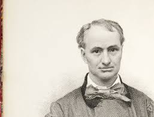<!-- .element: style="width:45%;float:right;margin-right:-1em;" -->

===

Leçon majeure : Toutes trois font apparaître des gros noeuds identifiables sur chaque cartes et sur lesquels on va revenir : Editis & Hachette, les deux gros géants. Ces noeud, ce sont les gruopes. 

L'apparition des groupes est un phénomène connu, qui procède donc de ce que j'ai qualifié de concentration éditoriale.

La concentration éditoriale désigne un processus au cours duquel quelques individus ou organisations accroissent progressivement leur contrôle sur les médias de masse (journaux, magazines, livres, télévisions, radios, sites internet, etc.), sur l'industrie culturelle ainsi que sur les groupes de communication (entreprise de sondages, téléphonie mobile, internet, etc.) et par là, sur les moyens de produire et de diffuser de l'information (au sens large) et des savoirs.

En France, la concentration éditoriale est un phénomène ancien, les historiens du livre ont démontré qu'elle commence dès le milieu du XIXe siècle, en pleine industrialisation de l'édition. Ce qu'il faut comprendre, c'est que l'émergence de l'édition comme métier ou plus largement ensemble de métiers, va de paire avec une concentration éditoriale progressive. 

Charles Baudelaire en 1861 pointait déjà les risques de la concentration et de ses cuisines peut ragoûtantes : « Avec l’achat de la Librairie Nouvelle […] la maison Michel Lévy frères devient des plus considérables. On a soulevé à cette occasion une question fort délicate : celle de savoir si, à moins de clause expresse, une propriété intellectuelle peut passer de Pierre à Paul ; si, par exemple, un auteur qui a voulu s’engager primitivement avec M. Bourdillat, le concessionnaire, et non avec M. Lévy, peut, sans être consulté, être vendu à celui-ci par celui-là… »

Certains groupes se démarquent par leur longévité, ce sont les groupes historiques : Les premiers grands groupes éditoriaux = Gallimard, devenu à la fin du XXe siècle Madrigall.

§§§§§§§§§§§§§§§§§§§§§§§§§§§§§§§§§§§§§§§§§§§§§

### De la concentration éditoriale aux "oligopoles à frange"

>En 1968, l’économiste américain George Stigler élabora le concept d’oligopole à frange pour
permettre de comprendre l’évolution des industries culturelles dans son pays. Son analyse insiste
sur la présence d’un petit nombre d’entreprises contrôlant la plus grande part d’un marché et ne
laissant à une multitude de petites structures que la frange ou les miettes du festin. (Jean-Yves Mollier)

<!-- .element: style="width:45%;float:left;margin-left:-1em; font-size:1.4rem; text-align:left" -->

<!-- .element: style="width:35%;float:right;margin-right:-1em;" -->

===

Pour JY Mollier, la concentration éditoriale s'est lourdement agravée depuis les années 2000, pour donner lieu à ce que l'on appelle un "oligopole" à frange.

>En 1968, l’économiste américain George Stigler élabora le concept d’oligopole à frange pour
permettre de comprendre l’évolution des industries culturelles dans son pays. Son analyse insiste
sur la présence d’un petit nombre d’entreprises contrôlant la plus grande part d’un marché et ne
laissant à une multitude de petites structures que la frange ou les miettes du festin.

(STIGLER George Joseph, The Organization of Industry, Homewood (Ill.), Richard D. Irving, 1968, et, pour la France,
REYNAUD-CRESCENT Bénédicte, L’Évolution de la branche d’édition de livres en France, thèse de doctorat en sciences
économiques, dir. J. Parent, université Paris I, 1982. )

§§§§§§§§§§§§§§§§§§§§§§§§§§§§§§§§§§§§§§§§§§§§§

<!-- .element: style="width:400px" -->

===

Les deux gros oligopoles français sont Hachette et Editis. 
Le planisphère nous dit que Hachette = 2,873 milliards d'euros de chiffre d'affaires en 2024
et pour Editis = 773 milliards de chiffre d'affaires.

Ce sont donc les 2 qui gagnent le plus.

Si on regarde Hachette Livre, on voit bien une illustration de la notion d'Oligopole à Franges : ce sont des dizaines de maisons d'édition qui sont inclues dans ce groupe, avec même des filières à l'étranger. 

Hachette = propriété du groupe Lagardère, lui-même propriété du groupe Vivendi, dirigé par le milliardaire français Vincent Bolloré, qui affiche depuis plusieurs années un ancrage à droite, voire très à droite.

Pour bien illustrer cette notion d'oligopole à Frange, les poupées russes se déroulent aussi dans l'autre sens : Certaines structures éditoriales d'Hachette renferment elles-mêmes plusieurs maisons, ce sont donc des groupes dans le groupe. Par exemple Fayard (cas sur lequel je vais revenir) est proprio de Pluriel, 1001 nuits, Pauvert, Mazarine !

§§§§§§§§§§§§§§§§§§§§§§§§§§§§§§§§§§§§§§§§§§§§§

#### La concentration éditoriale au XXIe siècle : une double croissance horizontale et verticale

>[La concentration éditoriale] s’est considérablement renforcée après 1945 et elle a véritablement changé de nature après 1980. En effet, pendant plus d’une centaine d’années, les achats d’entreprises s’effectuaient à l’intérieur de ce qu’il est convenu d’appeler une croissance horizontale et verticale du capital. La Librairie Hachette, par ses acquisitions permanentes de maisons d’édition concurrentes, illustre parfaitement les effets de cette croissance horizontale et, par ses rachats de papeteries,
d’imprimeries et de messageries, ceux de la croissance verticale destinée à lui permettre de
dominer toute la filière du livre.

<!-- .element: style="font-size:1.3rem; text-align:justify" -->

JY Mollier, Brève histoire de la concentration éditoriale dans le monde du livre, 2024

<!-- .element: style="font-size:1rem; text-align:right" -->

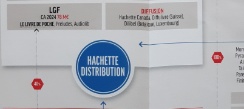<!-- .element: style="width:300px" -->

===

Toutefois, elle
s’est considérablement renforcée après 1945 et elle a véritablement changé de nature après 1980.
En effet, pendant plus d’une centaine d’années, les achats d’entreprises s’effectuaient à l’intérieur
de ce qu’il est convenu d’appeler une croissance horizontale et verticale du capital. La Librairie
Hachette, par ses acquisitions permanentes de maisons d’édition concurrentes, illustre
parfaitement les effets de cette croissance horizontale et, par ses rachats de papeteries,
d’imprimeries et de messageries, ceux de la croissance verticale destinée à lui permettre de
dominer toute la filière du livre.

§§§§§§§§§§§§§§§§§§§§§§§§§§§§§§§§§§§§§§§§§§§§§

>Jamais la concentration éditoriale n’a été aussi forte qu’au milieu des années 2020. [...] Rendue possible par la multiplication des opérations capitalistiques (fusions, acquisitions), **cette concentration est d’abord horizontale**, à travers la détention d’un grand nombre de maisons d’édition et de marques éditoriales. Elle est aussi **verticale**, par la maîtrise des principales sociétés de diffusion et de distribution, qui assurent la prise en charge des catalogues des éditeurs appartenant au groupe en même temps que ceux de nombreux éditeurs indépendants. Enfin, elle revêt une **dimension conglomérale**, en raison de l’intégration de certains de ces groupes éditoriaux au sein de conglomérats qui rassemblent des entreprises ayant des activités diversifiées, appartenant à des secteurs complètement différents.

<!-- .element: style="width:45%;float:left;margin-left:-1em; font-size:1.4rem; text-align:justify" -->

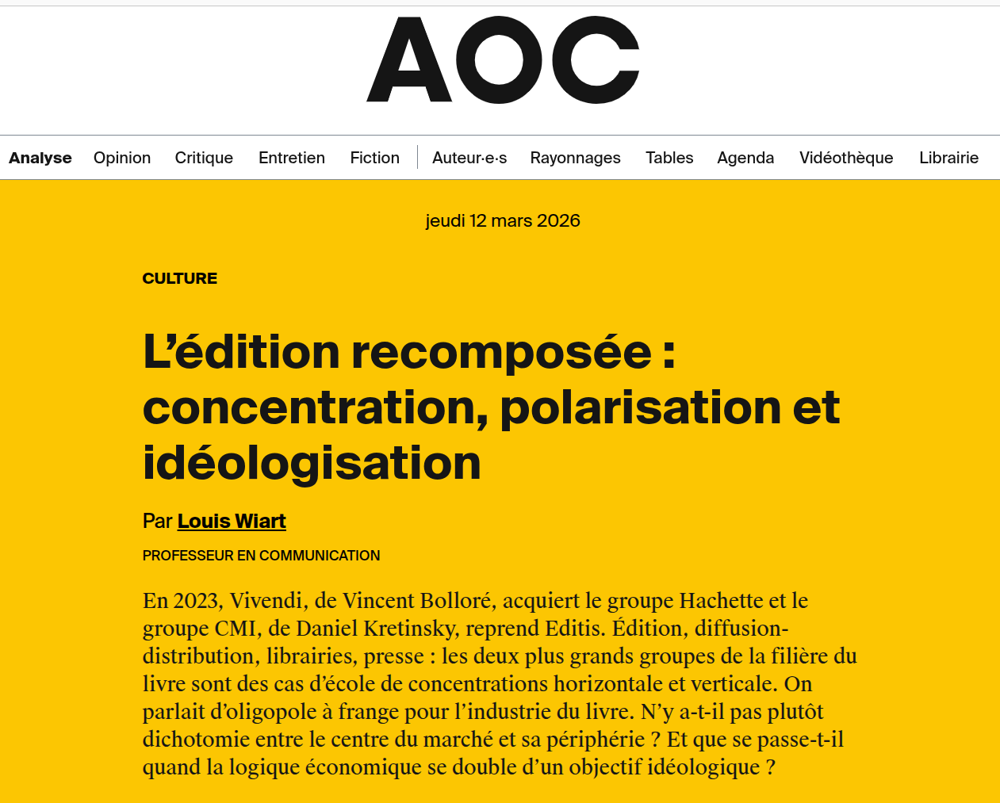<!-- .element: style="width:49%;float:right;margin-right:-1em;" -->

===

À partir des années 2000, le phénomène de concentration va connaître une forte accélération. L’édition française n’a jamais été aussi concentrée qu’aujourd’hui. 

Les cinq principaux groupes éditoriaux représentaient 56 % du chiffre d’affaires de l’édition française en 2000, contre près de 80 % en 2023. 

Aujourd'hui, les indépendants totalisent 10% à 12% du chiffre d’affaires global. Quant à eux deux, Hachette et Editis représentent 55% du marché. 

§§§§§§§§§§§§§§§§§§§§§§§§§§§§§§§§§§§§§§§§§§§§§

#### 2022, la menace de la fusion Éditis Hachette : le stade ultime de la concentration éditoriale ?

>La diversité, c’est la substance même de l’édition ; et c’est bien en son nom que la loi instituant un prix unique du livre a été votée à l’unanimité de la Chambre en 1981. [Antoine Gallimard]

>Sur le marché du livre, ce mélange des genres peut agir comme un cyclone. Avec son pouvoir d’attraction, le groupe de Vincent Bolloré pourrait assécher les terres de l’édition, en s’accaparant des droits à des prix d’acquisition hors marché. C’est un des piliers de notre culture du livre qui pourrait alors être atteint : la péréquation économique entre des livres de fonds et des livres d’exploitation rapide, laquelle permet le financement de la création dans toute sa diversité. [Antoine Gallimard]

<!-- .element: style="width:45%;float:left;margin-left:-1em; font-size:1.2rem; text-align:justify" -->

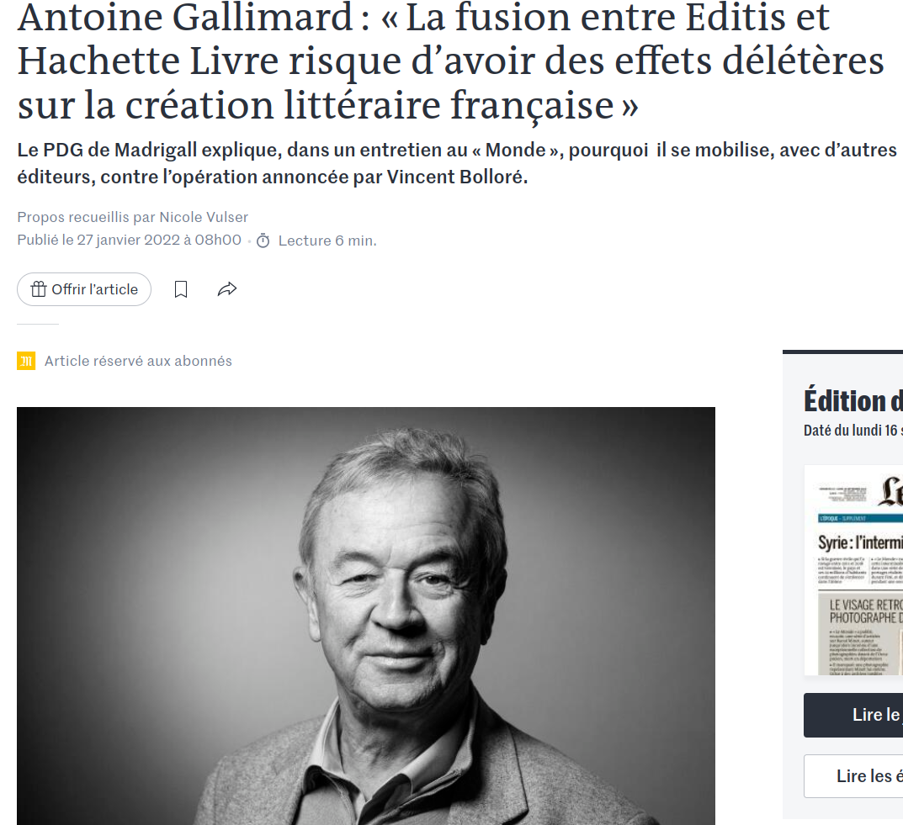<!-- .element: style="width:45%;float:right;margin-right:-1em;" -->

===

Aujourd'hui, en France, La concentration éditoriale donne lieu à une tension croissante entre les deux grands groupes éditoriaux français, ou les deux oligopoles à franges : Editis & Hachette. 

Ces deux plus gros acteurs de la concentration éditoriale sont des groupes qui relevaient jusqu'en 2023 de deux entités distinctes : 
- Editis était sous la houlette de Vivendi, propriété de Bolloré
- Hachette était détenu par Lagardère.

Inutile d'expliquer pourquoi, lorsque Vincent Bolloré a annoncé sa volonté de racheter Hachette, le secteur de l'édition tout entier s'est ému de la nouvelle, à l'image d'ANtoine Gallimard.

§§§§§§§§§§§§§§§§§§§§§§§§§§§§§§§§§§§§§§§§§§§§§

#### 2023-24 : le numéro un et le numéro deux de l'édition français changent de mains

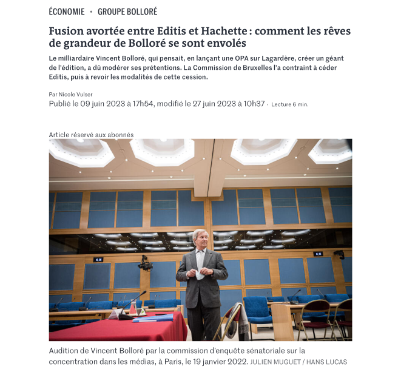<!-- .element: style="width:45%;float:left;margin-right:-1em;" -->

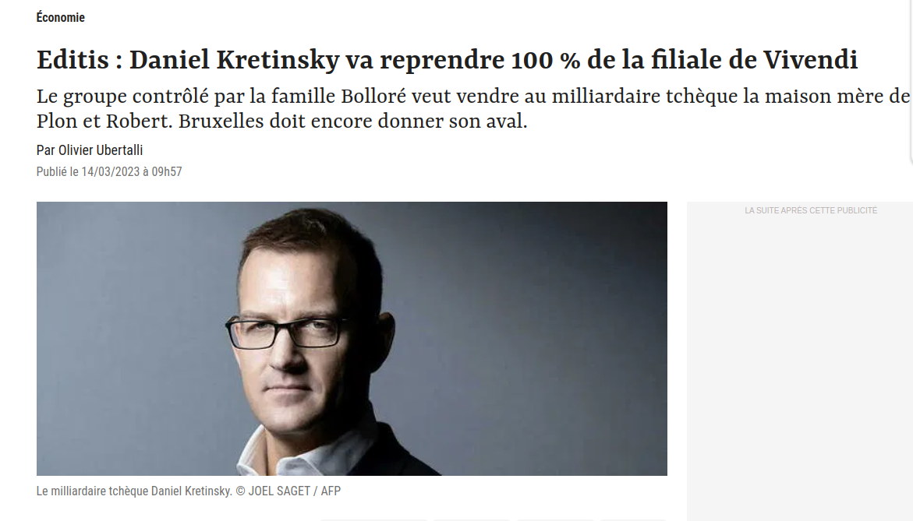<!-- .element: style="width:45%;float:right;margin-right:-1em;" -->

===

Les éditeurs français se sont bcp mobilisés, et finalement la commission européenne, qui effectue tout de même un contrôle des rachats de médias, a autorisé Bolloré à racheter Hachette à condition de céder Editis. 

Depuis 2023, Hachette est la propriété de Bolloré (d'où les tensions avec Saporta) et Editis est donc désormais sous la houlette de Daniel Kretinsky,  avocat, homme d'affaires et milliardaire tchèque : propriétaire des magazines Elle, Télé 7 Jours, Marianne, France Dimanche, Ici Paris, Usbek & Rica et Franc-Tireur. Par ailleurs entre octobre 2018 et septembre 2023, il est un actionnaire majeur du groupe Le Monde...

§§§§§§§§§§§§§§§§§§§§§§§§§§§§§§§§§§§§§§§§§§§§§

#### L'édition "intermédiaire", grande perdante de la concentration

L’industrie du livre est devenue de plus en plus polarisée, avec à la fois un phénomène de concentration extrême autour des grands groupes et un allongement de la « traîne » de l’édition par la multiplication des petits éditeurs indépendants. Cette double tendance s’accompagne d’un affaiblissement progressif de l’édition intermédiaire, dont la place sur le marché du livre tend à se réduire. Ce bouleversement des équilibres se retrouve jusque dans l’évolution des ventes. 

<!-- .element: style="font-size:1.3rem; text-align:center" -->

Louis Wiart, "L’édition recomposée : concentration, polarisation et idéologisation", AOC, 2026

<!-- .element: style="font-size:1.3rem; text-align:center" -->

§§§§§§§§§§§§§§§§§§§§§§§§§§§§§§§§§§§§§§§§§§§§§

#### Les risques de la concentration

* Contrôle des contenus littéraires à des fins marketing
<!-- .element: style="font-size:1.7rem; text-align:justify" -->

* Contrôle de la chaîne éditoriale à des fins d'exclusions des structures indépendantes
<!-- .element: style="font-size:1.7rem; text-align:justify" -->

* Contrôle des idées à des fins d'influence des foules (idéologie)
<!-- .element: style="font-size:1.7rem; text-align:justify" -->
 

#### Un risque avéré pour la bibliodiversité

===

Cela étant dit, ce qui caractérise notre époque, c'est l'influence politique des groupes éditoriaux. Bien qu'habituelles, ces convergences médiatiques font aujourd'hui débat, notamment concernant les intentions et poids politiques que ces groupes peuvent avoir. Cette dimmension politique est ce qui inquiète fortement les professionnels du secteurs éditorial dès lors qu'il est question de Vincent Bolloré dont le nom est associé de plus en plus à des courants de pensée d'extrême droite.

§§§§§§§§§§§§§§§§§§§§§§§§§§§§§§§§§§§§§§§§§§§§§

### La concentration et les logiques marketing

>Il y a un lien direct entre concentration, exigence de forte rentabilité et développement du livre-marketing. Quand une maison est rachetée par un groupe multinational, elle ne dispose d’une certaine marge d’autonomie que si ses résultats financiers sont conformes aux objectifs fixés par le groupe. Si cet objectif n’est pas tenu, la maison d’édition voit son budget sévèrement contrôlé et se trouve rapidement dépendante des autorisations de budget pour toute décision éditoriale. Jeanine Brémond, *L'édition sous influence*, 2003.

<!-- .element: style="width:55%;float:left;margin-left:-1em; font-size:1.2rem; text-align:right" -->

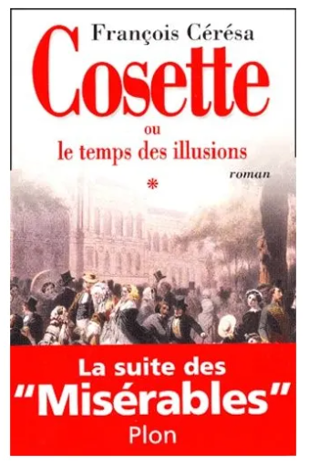<!-- .element: style="width:30%;float:right;margin-right:-1em;" -->

===

Le premier aspect de la concentration, c'est la question du catalogue et de la diversité des formes : diversité littéraire, notamment. 

L'argument de Bolloré dans le JDD, c'est la question économique, et en particulier marketing : un désaccord sur la date de sortie d'un livre. DIvergence de pt de vue sur le meilleur moment pour sortir un ouvrage. 

Et alors ? Vous pourriez me dire qu'il y a là rien de mal, c'est la règle du marché, l'édition a vocation à vendre.

Cela étant, si le livre est produit, est-ce un produit comme un autre ? Non, c'est un produit culturel.

De ce point de vue, Les effets de la concentration sont connus et dénoncés depuis plus d'un-demi siècle, en ce qu'ils modifient profondément les modes de fonctionnement des structures éditoriales et la diversité de l’offre : 

>Il y a un lien direct entre concentration, exigence de forte rentabilité et développement du livre-marketing. Quand une maison est rachetée par un groupe multinational, elle ne dispose d’une certaine marge d’autonomie que si ses résultats financiers sont conformes aux objectifs fixés par le groupe. Si cet objectif n’est pas tenu, la maison d’édition voit son budget sévèrement contrôlé et se trouve rapidement dépendante des autorisations de budget pour toute décision éditoriale.

https://www.acrimed.org/La-concentration-dans-l-edition-et-ses-effets

À l'époque, 2003, Brémond dénonçait surtout la fabrique de livres Marketing, notamment "Cosette ou le temps des illusions perdues" paru chez Plon (à l’époque Vivendi): À l’origine de ce roman, il y a une idée marketing qui repose sur deux éléments, la fascination qu’exerce le livre de Victor Hugo Les Misérables et un sujet de débat médiatisable : en effet, c'était plutôt audacieux de donner une suite au texte de Hugo. Et ça ne va pas louper, avec un procès au retentissement médiatique très fort, ce qui dispense l'éditeur de faire de la com. Ce qui pose problème dans cette logique marketing, c’est que les ventes d’un livre dépendent principalement, non de ses qualités intrinsèques (qui peuvent d’ailleurs être réelles), mais des modalités et de la puissance de la promotion du livre.

§§§§§§§§§§§§§§§§§§§§§§§§§§§§§§§§§§§§§§§§§§§§§

#### La stratégie de main-mise sur la chaîne éditoriale

<!-- .element: style="width:40%;float:right;margin-right:-1em;" -->

**Diffusion & distribution : la nouvelle concentration éditoriale**
 La concentration des activités de diffusion et de distribution constituent un risque majeur pour les éditeurs indépendants, manaçant la bibliodiversité.

<!-- .element: style="width:45%;float:left;margin-left:-1em; font-size:1.3rem; text-align:justify" -->

===

Le second aspect de la concentration = main mise sur les parties de la chaîne éditoriale qui maîtrisent le travail logistique et technique du livre, et qui met en place un contrôle de la chaîne éditoriale à des fins d'exclusions des structures indépendantes

Ce qui m'intéresse ici, ce sont ces petits camions dessinés sur la carte de l'asso pour l'écologie du livre, ou encore les gros points de distribution sur le planisphère. 

Le travail des distributeurs et diffuseur est souvent mal connu et mal compris, on les confond même d'ailleurs. Je vais y revenir rapidement, et on va enchaîner ensuite sur l'importance de ces deux piliers de l'édition dans le phénomène de concentration. 

§§§§§§§§§§§§§§§§§§§§§§§§§§§§§§§§§§§§§§§§§§§§§

#### Les distributeurs
* Fonctions : référencer, stocker, expédier, retourner, facturer
<!-- .element: style="font-size:1.4rem; text-align:justify" -->

* Sociétés : Volumen (Seuil), Sodis (Gallimard), Union (Flammation), Hachette (Hachette), Interforum (Editis)
<!-- .element: style="font-size:1.4rem; text-align:justify" -->

>« la distribution assume les tâches liées à la circulation physique du livre (stockage, transport) et à la gestion des flux financiers qui en sont la contrepartie (…) Entre 8 et 15 % du prix de vente du livre revient au distributeur. » (définition SNE)

<!-- .element: style="font-size:1.4rem; text-align:justify" -->

===

Pour bien comprendre, il faut revenir en amont de la chaîne de production d’un livre. Lorsque vous terminez la direction d’ouvrage avec votre éditeur, votre livre est prêt à être commercialisé. Vous signez alors un B.A.T. (bon à tirer), qui marque le top départ de votre publication et donc la fin du travail consacré à la création. Votre éditeur peut imprimer un certain nombre d’exemplaires au lancement. Votre livre est prêt à être distribuer et c’est là qu’intervient le distributeur.

Les métiers de la distributions sont principalement tournés vers la logistique et peut se résumer en quatre verbes : référencer, stocker, expédier, retourner, facturer.

En France, ils se nomment Volumen, Sodis, Union, Hachette, Interforum. Ils sont les principaux distributeurs français. La plupart de ces grands noms de la distribution ne vous disent rien, et pourtant ils sont tous des filiales de grandes maisons d’édition – respectivement Seuil, Gallimard, Flammarion, Hachette et Editis. 

La structure leader en France est représentée par Hachette Livre Distribution, qui appartient au groupe éponyme, lui-même propriété de Lagardère (donc Vivendi & Bolloré). 

En ayant acquis ou créé leurs structures de distribution, les grands groupes s'épargnent donc un gros travail logistique. Mais il vont aussi enfoncer un peu plus les indépendants, qui ne bénéficient pas de la même puissance de distribution, ou alors doivent en assumer les coûts.

§§§§§§§§§§§§§§§§§§§§§§§§§§§§§§§§§§§§§§§§§§§§§

#### Les diffuseurs
* Fonctions : commercial et marketing
<!-- .element: style="font-size:1.4rem; text-align:justify" -->

* Sociétés : Hachette, Sodis, Dilisco, Interforum
<!-- .element: style="font-size:1.4rem; text-align:justify" -->

>« la diffusion désigne l’ensemble des opérations commerciales et marketing mises en œuvre par les éditeurs dans les différents réseaux de vente (…) entre 4 et 7 % du prix de vente du livre revient au diffuseur ». (définition SNE)

<!-- .element: style="font-size:1.4rem; text-align:justify" -->

===

Le métier du diffuseur est principalement commercial et marketing. Il favorise la présence des livres dans les librairies physiques et sur les salons littéraires.
Si le distributeur permet à votre livre de pouvoir être acheté partout, le diffuseur fait en sorte qu’il soit vu partout, quel que soit le point de vente : librairies indépendantes, chaines, grandes surfaces, marchands de journaux, centrales d’achat, etc.

* Définition avec l'éditeur des objectifs de vente (combien d'exemplaires insérer sur le marché ?)
* Démarchage des points de vente pour faire connaître le catalogue de l'éditeur
* Produire et distribuer des supports de promotion
* Assurer le réassort des livres pour éviter les ruptures de stock

Aujourd'hui, les grands diffuseurs sont les sociétés qui gèrent également la distribution. On a donc les mêmes boites : effet de concentration, ces deux corps de métier qui étaient indépendants se sont rejoint dans des grosses boîtes. 

§§§§§§§§§§§§§§§§§§§§§§§§§§§§§§§§§§§§§§§§§§§§§

### Le graal de la diffusion et de la distribution

>La maîtrise des circuits de diffusion et de distribution constitue un enjeu central pour les éditeurs dans la mesure où elle conditionne la possibilité d’atteindre le consommateur final et de vendre les volumes nécessaires à la réalisation d’économies d’échelle. Or, ces circuits exigent des investissements colossaux, que seuls quelques acteurs majeurs sont en mesure d’assumer. Les économies d’échelle confèrent ainsi un avantage structurel pour les acteurs les plus puissants et favorisent une concentration du marché. 

<!-- .element: style="font-size:1.3rem; text-align:center" -->

Louis Wiart, "L’édition recomposée : concentration, polarisation et idéologisation", AOC, 2026

<!-- .element: style="font-size:1.3rem; text-align:center" -->

===

Si j'ai insisté aussi longtemps sur la distribution et la diffusion, ce n'est pas pour faire de vous des experts du stockage, mais pour comprendre que se joue ici un aspect logistique assez peu médiatisé de la concentration éditoriale, et pourtant aux très lourdres conséquences sur la bibliodiversité et l'indépendance.

Une enquête de l'asso des éditeurs indépendants montre que l'écrasante majorité des petites maisons indé 67 % (moins de 25.000 € de CA) assurent eux-mêmes leur diffusion, tandis que les maisons au CA supérieur à 250.000 € ont systématiquement recours à un diffuseur et un distributeur. Effet de précarisation. 

Comme nous l’avons vu, la diffusion et la distribution peuvent parfois être assurées par la même société. Mais la sélection à l’entrée est souvent un frein pour de nombreux éditeurs qui ne peuvent compter sur aucun distributeur, ni aucun diffuseur. Ils entretiennent alors du mieux possible leur réseau de libraires pour vendre vos livres. C’est un travail de titan qu’ils assure souvent uniquement dans leur secteur. Le stockage, l’expédition et la facturation des commandes leur incombent aussi. Ces éditeurs-là sont des héros, mais leur efficacité est bien moindre que celle d’éditeurs entourés d’un distributeur et d’un diffuseur.

§§§§§§§§§§§§§§§§§§§§§§§§§§§§§§§§§§§§§§§§§§§§§

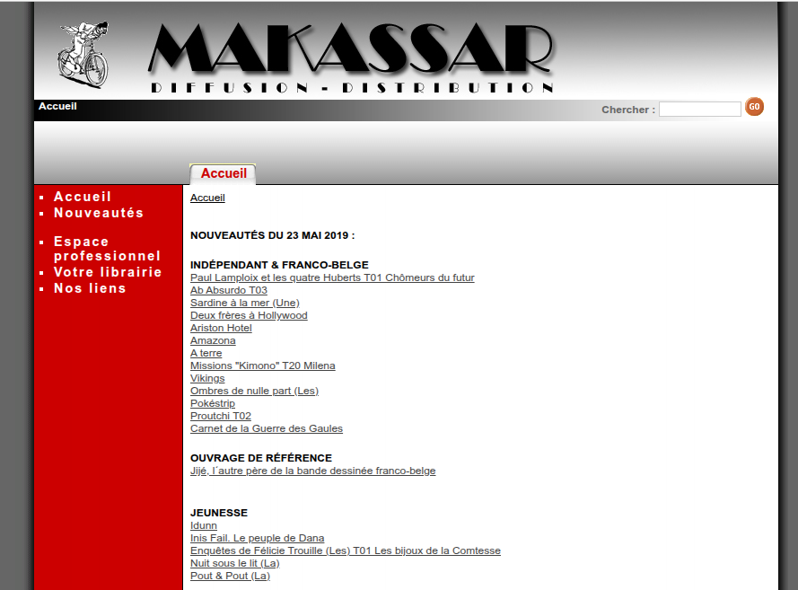<!-- .element: style="width:45%;float:left;margin-right:-1em;" -->

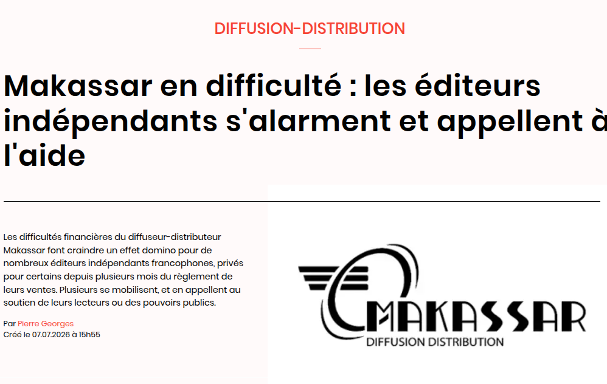<!-- .element: style="width:45%;float:right;margin-right:-1em;" -->

§§§§§§§§§§§§§§§§§§§§§§§§§§§§§§§§§§§§§§§§§§§§§

#### Concentration et contrôle des contenus et des idées 

>si l’aval de la chaîne du livre (diffusion et distribution) impose une logique industrielle qui favorise la concentration des moyens, en revanche l’activité éditoriale en amont, créative et intellectuelle, obéit par essence à une logique « artisanale » qui ne peut être standardisée. C’est pourquoi les maisons d’édition abritées dans les grands groupes jouissent d’une autonomie de leur politique éditoriale. En effet, l’intérêt économique des groupes d’édition est de ne pas confondre le rôle de l’éditeur avec celui de l’actionnaire.

<!-- .element: style="font-size:1.3rem; text-align:center" -->

Serge Eyrolles, *Les 100 mots de l’édition* (PUF, 2009)
<!-- .element: style="font-size:1.3rem; text-align:center" -->

===

Comme Louis Wiart le questionne lui-même : La domination des grands groupes ne marque-t-elle pas le triomphe de la rationalité gestionnaire aux dépens des exigences de la création ?

>si l’aval de la chaîne du livre (diffusion et distribution) impose une logique industrielle qui favorise la concentration des moyens, en revanche l’activité éditoriale en amont, créative et intellectuelle, obéit par essence à une logique « artisanale » qui ne peut être standardisée. C’est pourquoi les maisons d’édition abritées dans les grands groupes jouissent d’une autonomie de leur politique éditoriale. En effet, l’intérêt économique des groupes d’édition est de ne pas confondre le rôle de l’éditeur avec celui de l’actionnaire.

§§§§§§§§§§§§§§§§§§§§§§§§§§§§§§§§§§§§§§§§§§§§§

>Sauf que la logique économique n’est plus la seule présente dans ces mouvements industriels : la récente prise de contrôle d’Hachette par le milliardaire néoconservateur Vincent Bolloré a consolidé le positionnement de son conglomérat dans le livre et les médias, dans une perspective d’influence idéologique. Au sein d’Hachette, la maison d’édition Fayard a ainsi été réorganisée afin de multiplier la publication de livres de personnalités de droite et d’extrême droite, au premier rang desquelles Nicolas Sarkozy, Sonia Mabrouk, Marion Maréchal Le Pen, Jordan Bardella, Éric Zemmour et Philippe de Villiers.

<!-- .element: style="font-size:1.3rem; text-align:center" -->

Louis Wiart, "L’édition recomposée : concentration, polarisation et idéologisation", AOC, 2026

<!-- .element: style="font-size:1.3rem; text-align:center" -->

===

>Sauf que la logique économique n’est plus la seule présente dans ces mouvements industriels : la récente prise de contrôle d’Hachette par le milliardaire néoconservateur Vincent Bolloré a consolidé le positionnement de son conglomérat dans le livre et les médias, dans une perspective d’influence idéologique. Au sein d’Hachette, la maison d’édition Fayard a ainsi été réorganisée afin de multiplier la publication de livres de personnalités de droite et d’extrême droite, au premier rang desquelles Nicolas Sarkozy, Sonia Mabrouk, Marion Maréchal Le Pen, Jordan Bardella, Éric Zemmour et Philippe de Villiers.

§§§§§§§§§§§§§§§§§§§§§§§§§§§§§§§§§§§§§§§§§§§§§

##### L'Affaire Fayard : les prémices d'une droitisation de l'édition ?

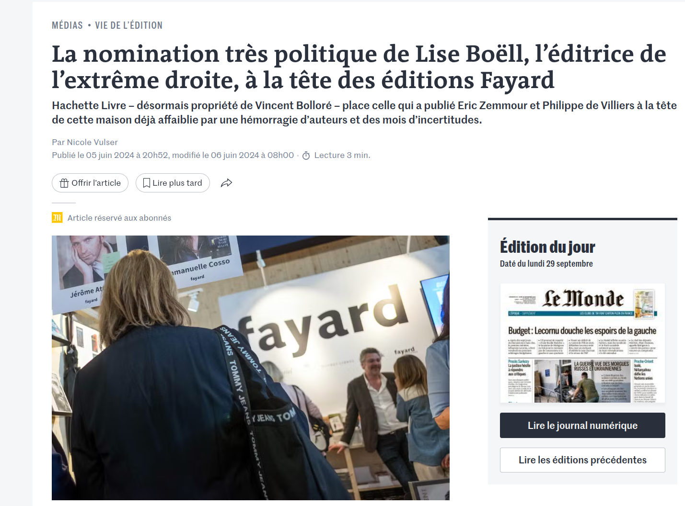<!-- .element: style="width:500px" -->

===

Pour aborder la problématique du contrôle des contenus et des idées, rien de mieux que d'évoquer les multiples affaires "fayard", du nom de cette maison d'édition qui, depuis plusieurs années, fait régulierement la Une des journaux pour des problèmes supposés d'indépendance politique.

Dernier drame en date : Lise Boell nommée directrice des éditions, afin de remplacer Isabelle Saporta. 
Lise Boëll est une éditrice française, connue pour avoir publié des auteurs comme Éric Zemmour et Philippe de Villiers. 
Son arrivée à Fayard a été marquée par une polémique, notamment en raison de son positionnement éditorial et de son passé d’éditrice d’auteurs d’extrême droite.

§§§§§§§§§§§§§§§§§§§§§§§§§§§§§§§§§§§§§§§§§§§§§

#### Avril 2024 : licenciement d'Isabelle Saporta

>Déstabilisée, Isabelle Saporta a refusé tout compromis avec [Lise Boëll] l’ex-éditrice d’Eric Zemmour et s’est opposée à toute collaboration avec elle. En désaccord stratégique avec son actionnaire, qui veut manifestement donner une nouvelle ligne politique à une autre maison d’édition historique, Isabelle Saporta est remerciée.

<!-- .element: style="width:45%;float:left;margin-left:-1em; font-size:1.4rem; text-align:justify" -->

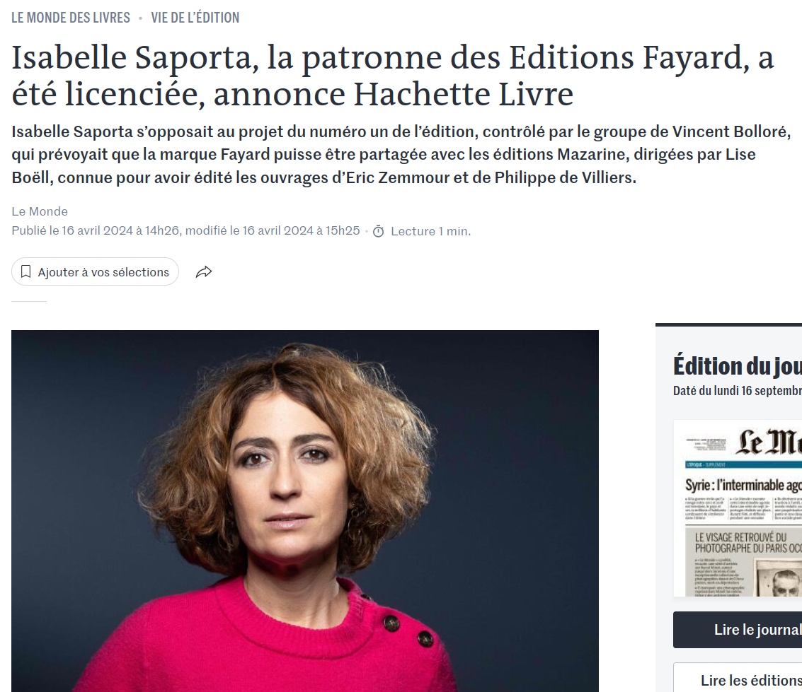<!-- .element: style="width:45%;float:right;margin-right:-1em;" -->

===

Il faut dire que l'arrivée de Lise Boëll s'est effectuée au prix d'un limogeage, avec le licenciement de la PDG de Fayard, Isabelle Saporta en avril 2024.

Licenciée pour avoir refusé de céder un accord de licence permettant l’utilisation de la marque de la maison au profit de l’ancienne éditrice d’Eric Zemmour, Lise Boëll, qui était à l'époque éditrice pour Plon (vous vous souvenez ? Mazarine fait partie du groupe Fayard, lui-même propriété d'Hachette, lui-même chez Lagardère, lui-même chez Vivendi... propriété de Bolloré).

Marquée très à droite, cette dernière a également publié des ouvrages de Philippe de Villiers et, selon L’Obs, s’apprête à signer avec le président du Rassemblement national, Jordan Bardella. Lise Boëll a été nommée directrice générale des éditions Mazarine, une filiale créée par Fayard en 1979, le 22 février. Mais elle souhaitait que ses auteurs puissent signer sous la marque Mazarine/Fayard, profitant ainsi de la renommée de la maison historique.

Comment Lise Boëll a-t-elle pu obtenir la tête de Saporta, pourtant directrice d,une grande maison comme Fayard ? Parce qu'elle avait le soutient de Vincent Bolloré, qui a racheté en 2023 le groupe Hachette, dont Fayard fait partie... 

§§§§§§§§§§§§§§§§§§§§§§§§§§§§§§§§§§§§§§§§§§§§§
<!-- .slide: data-background-image="img/" data-background-size="contain" -->

#### 2022. Licenciement de Sophie de Closets

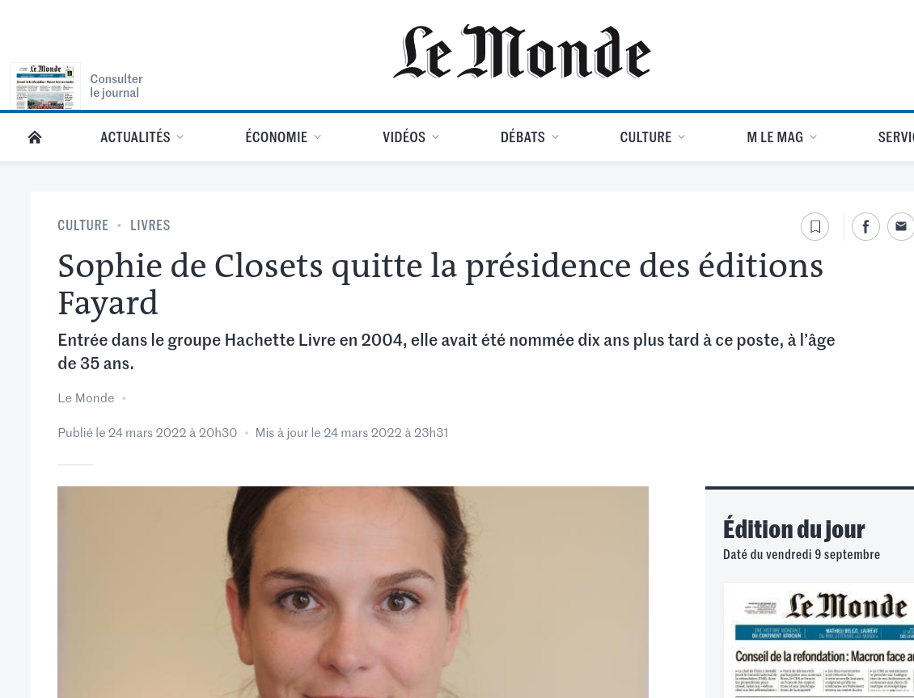<!-- .element: style="width:45%;float:left;margin-right:-1em;" -->

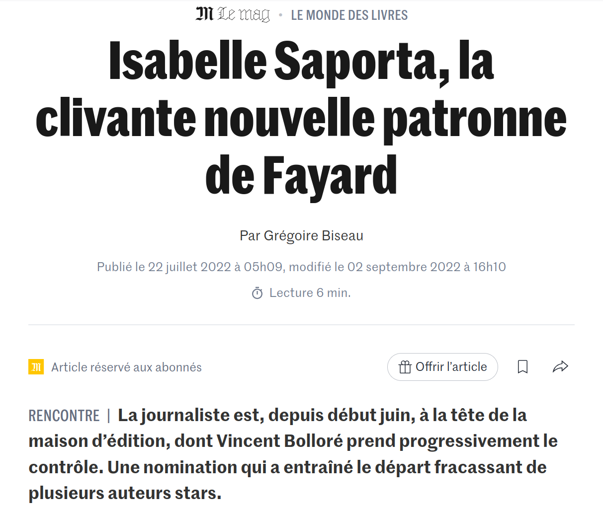<!-- .element: style="width:45%;float:right;margin-right:-1em;" -->

===

Saporta victime de la droitisation de l'édition, et de la concentration éditoriale ? N'allons peut-être pas si vite en besogne. 

Il y a trois ans, Le 24 mai 2022, c'est en effet Sophie de Closets, présidente-directrice générale des éditions Fayard, quittait son poste après avoir subit notamment des pressions de la part d'Hommes politiques dont Sarkozy, après la publication de Gérard Davet et Fabrice Lhomme, sur l'affaire Fillon.

À l'époque, ce n'est pas Vincent Bolloré qui dirige Hachette, c'est encore Arnaud Lagardère, très proche de Nicolas Sarkozi. Selon les médias, et les principaux intéressés, c'est bien Nicolas Sarkozy qui exige le départ de Sophie de Closets, pour placer Isabelle Saporta, qui n'était alors "que" directrice de collection : statut tout à fait honnorable, mais relativement peu suffisant pour devenir PDG d'une aussi grande maison.

Cependant voilà : Hachette Livre est passé à la fin de 2023 sous le contrôle de Vivendi, groupe du milliardaire Vincent Bolloré, accusé par de nombreux rivaux de vouloir se servir de ses maisons d’édition pour promouvoir un projet politique très à droite -- encore plus à droite que la droite de NS. C'est dans ce nouveaux contexte que s'est joué le départ d'Isabelle Saporta, 2 ans tout juste après son arrivée à la tête de la maison d'édition.

Difficile de ne pas des influences politiques dans ces décisions managériales mais également éditoriales.

§§§§§§§§§§§§§§§§§§§§§§§§§§§§§§§§§§§§§§§§§§§§§

### Comment penser   l'indépendance éditoriale ? 

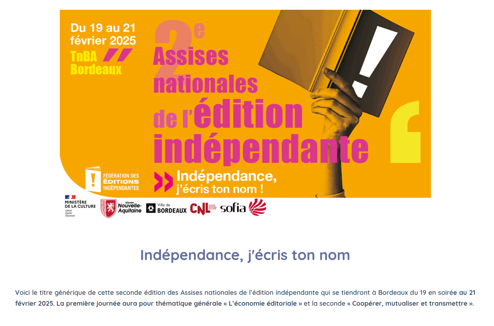<!-- .element: style="width:500px" -->

===

Nous abordons le dernier temps de ce cours, dans lequel je voudrais évoquer avec vous la question des modèles d'édition alternatifs, incarnés notamment par ce que l'on appelle de manière assez large "des éditeurs indépendants".  

Je vais en rester, pour ce cours-ci, à des considérations plutôt théoriques, et on aura le temps dans le semestre de développer des exemples plus concrets.

Disons-le tout de suite, les éditions indés sont un défi :
- elles constituent des cas limites, car économiquement ils ne sont souvent pas viables
- ils incarnent un pourcentage important de l'édition en France (de 30 à 40%, c'est selon : on va voir que c'est compliqué à définir un éditeur indé), et favorisent un principe de bibliodiversité essentiel à notre culture.

Bref : il s'agit d'une activité éditoriale qui, comme pour les auteurs, ne sont suffisent svt pas à vivre, et donc apparaissent comme une activité complémentaire, voire un hobby... 

§§§§§§§§§§§§§§§§§§§§§§§§§§§§§§§§§§§§§§§§§§§§§

### Éditeurs indépendants ? Une réalité multiple

* Une édition en marge des grands groupes
* Une définition floue et une institutionnalisation récente
* Un enjeu de bibliodiversité

<!-- .element: style="width:45%;float:left;margin-left:-1em; font-size:1.4rem; text-align:left" -->

<!-- .element: style="width:45%;float:right;margin-right:-1em;" -->

===

La notion d'éditeur indépendant recouvre une multitude de réalités, et ne fait d'ailleurs pas toujours l'objet d'un concensus. Par son principe même, l'édition indépendante a tendance à échapper à l'institutionnalisation. 

Dans un sens large, l'indépendance se pense d'abord en opposition à la notion de groupe éditorial. Aujourd'hui, 65 % de l’édition française sont détenus par les géants Hachette Livre et Editis (respectivement = Bolloré et Kretinsky), auxquels il faut ajouter les autres groupes (Madrigall, Média Participations…). Déjà, on voit que mon propos peut être problématique, dans la mesure où je mets dans le même pannier Madrigall (Gallimard - encore une maison familiale aujourd'hui ; ou même Actes Sud qui appartient encore à la famille Nyssen) et Hachette de Bolloré. 

La notion d'éditeur indépendant se pense d'abord dans ce contexte d'une concentration des maisons d’édition est extrême, où l’édition indépendante est marginale.

La qualification « édition indépendante », dans ce sens, désigne les maisons d'édition, souvent de petite taille, mais pas toujours (Actes Sud est une grande maison), qui n'appartiennent pas aux groupes d'édition qui forment aujourd'hui l'oligopole en réseau de l'édition et des médias.

§§§§§§§§§§§§§§§§§§§§§§§§§§§§§§§§§§§§§§§§§§§§§

>Le cas d'Actes Sud incarne « l’ambivalence du discours de l’indépendance et les dissonances entre la présentation de soi, les récits d’entreprise et la division du travail ; en bref, entre les moyens de production et les discours qui les justifient »  Julien Lefort-Fravreau, *Le Luxe de l’indépendance. Réflexions sur le monde du livre*, Montréal, Lux, 2021.

<!-- .element: style="width:45%;float:left;margin-left:-1em; font-size:1.4rem; text-align:justify" -->

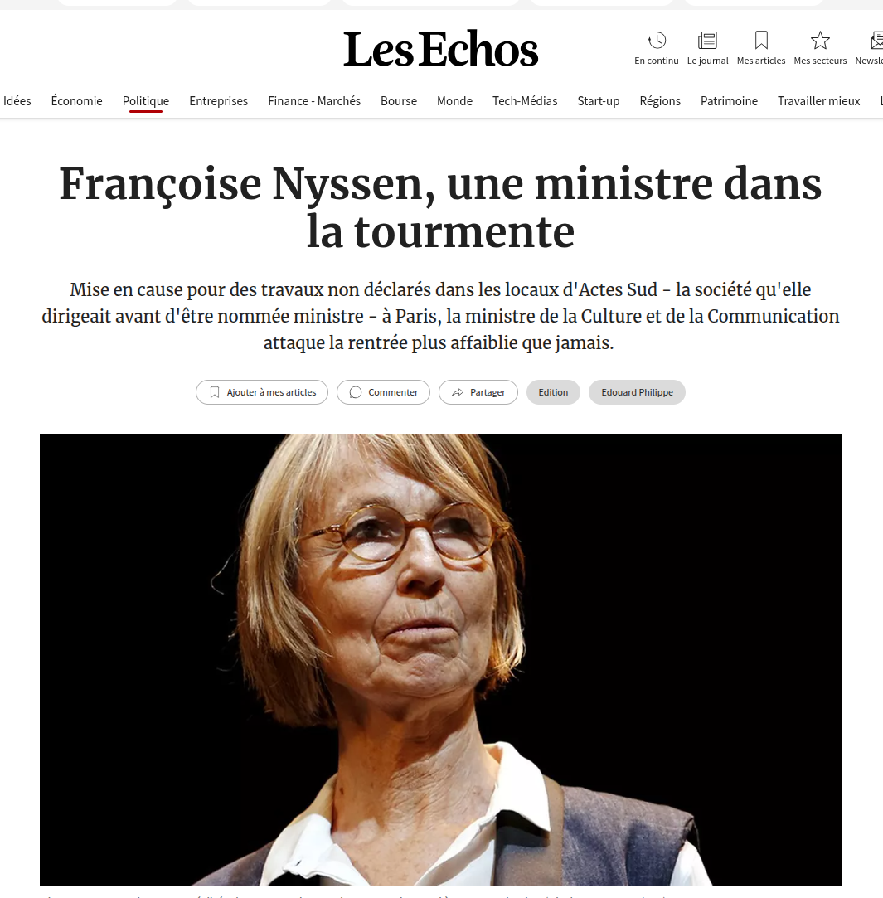<!-- .element: style="width:50%;float:right;margin-right:-1em;" -->

===

l’indépendance n’est jamais qu’une « position de départ » (p. 52) et ne reflète en rien la trajectoire complète d’une structure, comme le révèle l’histoire de l’éditeur français Actes Sud (p. 45-61). Tout en passant d’une petite maison indépendante créée dans une bergerie près d’Arles en 1978 à un groupe particulièrement puissant (tant d’un point de vue économique que symbolique), Actes Sud a maintenu une rhétorique faisant la part belle à son indépendance originelle et à un idéal artisanal. Les activités de la maison – diversification des activités du groupe, rachat de petites structures d’édition, constitution d’un important capital immobilier –, tout comme la trajectoire de l’héritière de la structure, Françoise Nyssen, qui devint pour un temps ministre de la Culture, semblent contradictoires avec ces déclarations. Cet exemple permet de rendre compte de « l’ambivalence du discours de l’indépendance », et plus particulièrement « les dissonances entre la présentation de soi, les récits d’entreprise et la division du travail ; en bref, entre les moyens de production et les discours qui les justifient » (p. 55).

§§§§§§§§§§§§§§§§§§§§§§§§§§§§§§§§§§§§§§§§§§§§§

### L'indépendance selon la fédération des éditions indépendantes 

* Publier uniquement à compte d’éditeur des publications de toute nature, commercialisées auprès du public,
* Ne pas être contrôlée, directement ou indirectement, par l’État, une collectivité territoriale ou un établissement public, par un groupe d’éditions ou un groupe financier et
* Réaliser un chiffre d’affaire dont le montant annuel ne dépasse pas 10 millions d’euros.

<!-- .element: style="width:45%;float:left;margin-left:-1em; font-size:1.4rem; text-align:left" -->

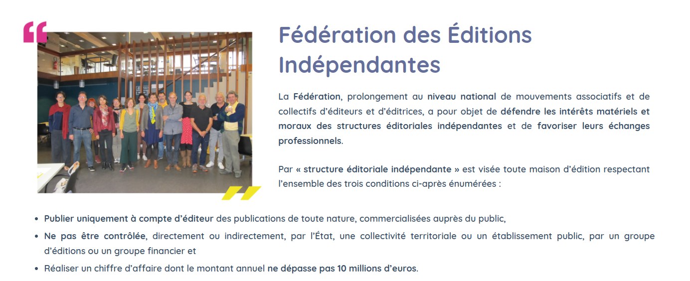<!-- .element: style="width:45%;float:right;margin-right:-1em;" -->

===

Dans un contexte d'amplification majeur de la concentration éditoriale, ainsi que de politisation croissante des grands groupes éditoriaux, les éditeurs indépendants ont tenté ces dernières années de s'organiser.

En 2023, la FEDEI, pour Fédération des éditions indépendantes (éditions plutôt que éditeurs) a ainsi organisé les premières assises des indépendants. 2e édition à venir en 2025, à Bordeau. Il s'agit d'une jeune Fédération, qui attire de plus en plus l'attention sur elle. 

Définition de la FEDEI. 

La FEDEI estime approximativement à 2500, le nombre de maisons d’éditions indépendantes sur le territoire national, répondant à ces critières. 

>Elles ne sont pourtant que très peu représentées auprès des pouvoirs publics. Nous constituons un maillage dense et riche, porteurs d’emplois et culture. Mais nous sommes peu visibles et fragiles face à l’offre pléthorique dont les grands groupes éditoriaux abreuvent le marché. 

§§§§§§§§§§§§§§§§§§§§§§§§§§§§§§§§§§§§§§§§§§§§§

### L'indépendance ...

* Économique 
* Éditoriale / idéologique (une édition _engagée_)
* Créative / esthétique (une édition alternative)

<!-- .element: style="font-size:1.3rem; text-align:justify" -->

### ... et ses défis
* Économiques (rentabilité moindre voire nulle)
* Logistiques (Distribution et Diffusion)

<!-- .element: style="font-size:1.3rem; text-align:justify" -->

===

Il existe donc de nombreuses manière de considérer son indépendance. Indépendance financière : des modèles économiques souvent non-rentables. Beaucoup de ces passionnés ne vivent pas de leur activité, avec la nécessité d’avoir plusieurs emplois, de réaliser des ateliers et autres prestations.

Une indépendance que je note ici "éditoriale ou idéologique", mais que j'aurais pu qualifier de politique. 

Une indépendance créative, enfin. 

Tout cela ne va pas sans difficultés.

§§§§§§§§§§§§§§§§§§§§§§§§§§§§§§§§§§§§§§§§§§§§§

#### Le débat de l'indépendance

La question de l’indépendance c’est considérablement complexifiée, à tel point qu’elle devient difficile à définir. Et pourtant il est indispensable de nommer et de qualifier cette façon très politique de faire de l’édition de création, si singulière et si différente de l’« édition de groupe ». Si l’on se concentre exclusivement sur le capital, donc une indépendance économique, c’est oublier la dépendance économique dans laquelle sont placées des structures qui ont recours à une diffusion distribution déléguées, qu’elle soit ou non rattachée à un groupe éditorial. La question de liberté et la qualité de choix éditoriaux ne peuvent pas non plus être utilisé seuls comme outil de définition de l’indépendance, la liberté et la qualité éditoriale se retrouvant tant dans les publications de collections appartenant à des groupes que dans celles des structures indépendantes. 

<!-- .element: style="font-size:1.4rem; text-align:justify" -->

>Benoît Laureau, co-fondateur de L’Ogre, dans « (Re)définir l’indépendance », Livre Hebdo, 2024.

<!-- .element: style="font-size:1.3rem; text-align:right" -->

§§§§§§§§§§§§§§§§§§§§§§§§§§§§§§§§§§§§§§§§§§§§§

L’indépendance serait donc surtout une question d’état d’esprit et de capacité à contrôler à minima la manière d’éditer, de fabriquer et de commercialiser le livre. Mais ce que révèle surtout cette tentative de définition, c’est que, derrière de nos indépendances individuelles (auteurs, éditeurs, libraires, diffuseurs-distributeurs), se cache une interdépendance très concrète et politique. Et il me semble aujourd’hui beaucoup plus intéressant de se concentrer sur cette notion, de la définir et s’en servir pour construire une véritable chaine du livre indépendant qui permettrait d’apporter un ensemble de réponse à nos préoccupations sociales, écologiques, et économiques.

<!-- .element: style="font-size:1.4rem; text-align:justify" -->

>Benoît Laureau, co-fondateur de L’Ogre, dans « (Re)définir l’indépendance », Livre Hebdo, 2024.

<!-- .element: style="font-size:1.3rem; text-align:right" -->

§§§§§§§§§§§§§§§§§§§§§§§§§§§§§§§§§§§§§§§§§§§§§

### Bibliodiversité : des modèles alternatifs

>« Indépendante » pour définir l’édition, est-ce là le bon terme ? Nous incarnons une mosaïque, pas un monolithe. Quel est le plus petit dénominateur commun à même d’exprimer nos singularités ? Voilà un aspect à cerner : que la perception devienne un portrait.

<!-- .element: style="font-size:1.4rem; text-align:justify" -->

>Dominique Tourte, Président de la FEDEI

<!-- .element: style="font-size:1.3rem; text-align:justify" -->

===

L'indépendance, également, renvoie à un enjeu de diversité, ce qui est plutôt logique, lorsque l'on songe au principe d'uniformisation qui caractérise les grands groupes. Ce que l'on qualifiera de bibliodiversité, ici, renvoie à une variété des idées véhiculées par les livres, une variété des publics visés, mais également une variété des formes éditoriales envisagées. 

Camille Delettre, à la tête de la maison L’Atteinte. Pour ce dernier, le terme indépendant est problématique, lui préférant « alternatif, plus proche de la réalité ». Il ne rejette certes pas le commerce, mais le souhaite éthique et moral, sans compromission.

§§§§§§§§§§§§§§§§§§§§§§§§§§§§§§§§§§§§§§§§§§§§§

#### Une réflexion à poursuivre dans les prochains cours... 

§§§§§§§§§§§§§§§§§§§§§§§§§§§§§§§§§§§§§§§§§§§§§

### Envisager l'indépendance financière
* Financements participatifs
* Le coût de l'indépendance

<!-- .element: style="width:45%;float:left;margin-left:-1em; font-size:1.4rem; text-align:justify" -->

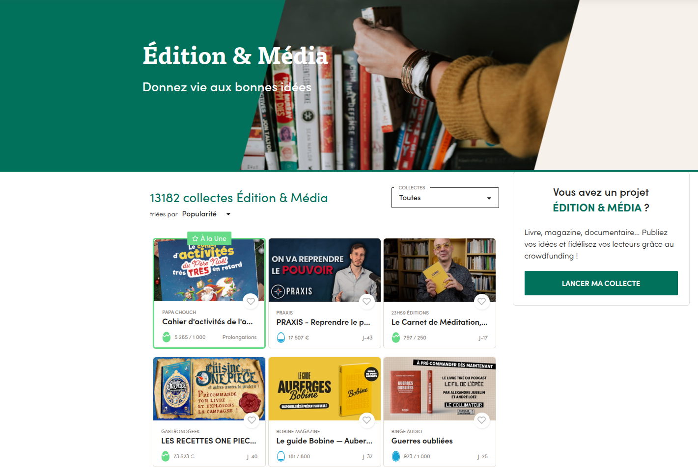<!-- .element: style="width:45%;float:right;margin-right:-1em;" -->

§§§§§§§§§§§§§§§§§§§§§§§§§§§§§§§§§§§§§§§§§§§§§

### Repenser les enjeux de _publication_ 

* Modèles hors le livre
* Édition numérique

<!-- .element: style="width:45%;float:left;margin-left:-1em; font-size:1.4rem; text-align:justify" -->

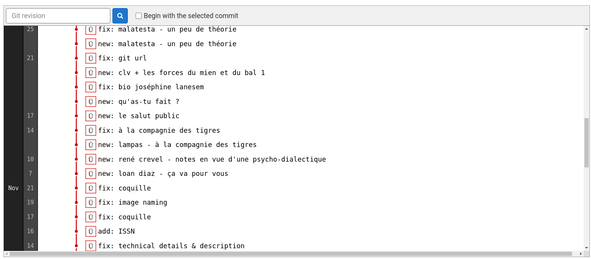<!-- .element: style="width:45%;float:right;margin-right:-1em;" -->

§§§§§§§§§§§§§§§§§§§§§§§§§§§§§§§§§§§§§§§§§§§§§

### Repenser les échelles et l'artisanat éditorial

* _Small press_, 
* Petite édition, 
* _micro-édition_
* Fanzine, POD...

<!-- .element: style="width:45%;float:left;margin-left:-1em; font-size:1.4rem; text-align:justify" -->

<!-- .element: style="width:45%;float:right;margin-right:-1em;" -->

===

pour de faibles tirages, un nombre réduit de titres & une fabrique artisannale

§§§§§§§§§§§§§§§§§§§§§§§§§§§§§§§§§§§§§§§§§§§§§

### L'auto-édition, une solution ? 

<!-- .element: style="width:400px" -->

§§§§§§§§§§§§§§§§§§§§§§§§§§§§§§§§§§§§§§§§§§§§§

### Les GAFAM : la menace de la concentration numérique

<!-- .element: style="width:500px" -->

§§§§§§§§§§§§§§§§§§§§§§§§§§§§§§§§§§§§§§§§§§§§§

## Conclusion

La question de la gouvernance éditoriale pose celle de l'influence des grands groupes sortis vainqueurs des batailles pour la concentration éditoriale aux XX et XXIe siècles. L'actualité brûlante de cette concentration pose aujourd'hui Hachette et Editis en leader du marché, qui comprend aussi bien un catalogue d'auteurs (et d'idées) qu'une structure logistique qui leur permet de conserver leur domination. Dans ce contexte, l'indépendance éditoriale apparaît comme un "luxe" (Favreau) et fait face à des défis multiples, mais semble plus essentielle que jamais. Cet état des lieux ouvre à de nouveaux questionnements, sur l'auto-édition, les modèles éditoriaux alternatifs, ainsi que les effets de concentration à venir, liés à l'essor de l'édition numérique.

<!-- .element: style="font-size:1.7rem; text-align:justify" -->
